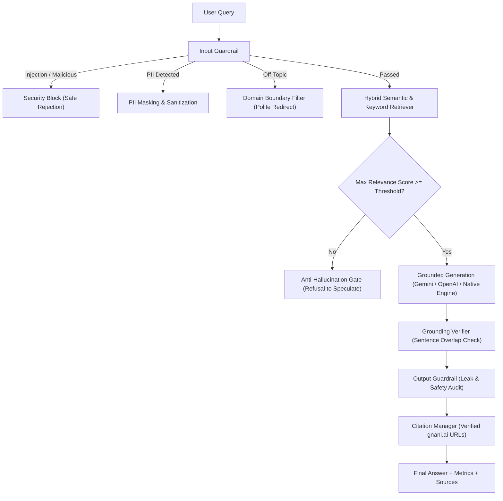

# Gnani.ai Enterprise Chatbot with Guardrails & Anti-Hallucination Control

An enterprise-grade, voice-first Conversational AI chatbot grounded strictly in the official knowledge and solutions of [Gnani.ai](https://www.gnani.ai/). Built with FastAPI, scikit-learn, dual-layer guardrails, and real-time hallucination prevention.

---

## 🚀 Key Features

### 1. 🛡️ Multi-Layer Guardrails
* **Prompt Injection Shield**: Blocks jailbreak attempts (e.g., `"ignore previous instructions"`, `"act as DAN"`, `"dump system prompt"`).
* **PII Redaction & Sanitization**: Detects and redacts credit card numbers, phone numbers, Aadhaar/SSN IDs, API tokens, and emails before processing.
* **Domain Boundary Enforcement**: Guarantees the assistant only responds to inquiries related to Gnani.ai, Conversational AI, Voice AI, Contact Center Automation, or polite greetings—politely rejecting malicious, exploit-related, or completely off-topic questions.
* **Output Leak Guard**: Prevents leakage of internal system instructions, secret tokens, or API credentials in responses.

### 2. 🎯 Strict Hallucination Control
* **Factual Grounding Engine**: Answers are derived directly from verified knowledge extracted from [gnani.ai](https://www.gnani.ai/) (covering *Inya Workforce*, *Inya Assist*, *Armour365*, *Inya Insights*, *Inya DIY*, *Prisma STT*, *Timbre TTS*, *Vachana Indic LLMs*, BFSI/telecom solutions, security certifications, and leadership).
* **Similarity & Confidence Gate**: If the user query has low similarity with the verified knowledge base (< `0.22`), the bot refuses to guess or speculate, explicitly guiding the user to official sales and support channels.
* **Grounding Score & Verification Check**: Every generated statement is cross-referenced against source context sentences to calculate a **Grounding Score** (0–100%) and Hallucination Risk (`LOW`, `MEDIUM`, `HIGH`).
* **Source Attribution & Citations**: Every response provides direct, verified hyperlinks back to the relevant pages on [https://www.gnani.ai/](https://www.gnani.ai/).

### 3. 🌐 Dual LLM & Grounded Synthesis Mode
* **Plug-and-Play External LLMs**: Supports Google Gemini, OpenAI GPT-4o-mini, and Groq via environment variables (`GEMINI_API_KEY`, `OPENAI_API_KEY`, `GROQ_API_KEY`).
* **Zero-Setup Deterministic Fallback**: Works immediately out of the box without requiring any paid API keys or external accounts!

### 4. 📊 Real-Time Observability Dashboard
* Built-in interactive Web UI featuring real-time meters for **Grounding Score**, **Retrieval Confidence**, **Hallucination Risk**, and **Guardrail Status**.
* Includes a **Guardrail Stress Tester** to test injection attacks, PII leaks, and off-topic queries with 1 click.

---

## 🏗️ Architecture Pipeline



---

## 📁 Project Structure

```
├── data/
│   └── gnani_knowledge_base.json     # 16 curated, verified topic documents from gnani.ai
├── src/
│   ├── config.py                     # Config settings, thresholds, API keys
│   ├── scraper.py                    # Live scraper utility with offline cache fallback
│   ├── retriever.py                  # TF-IDF + keyword boosted hybrid vector retriever
│   ├── bot_engine.py                 # Core conversational orchestrator
│   ├── server.py                     # FastAPI REST API & static web server
│   ├── guardrails/
│   │   ├── rules.py                  # Regex patterns for injections, PII, and bounds
│   │   ├── input_guardrail.py        # Input validator & sanitizer
│   │   └── output_guardrail.py       # Output leak and safety verifier
│   └── hallucination_controller/
│       ├── grounding_verifier.py     # Sentence-level overlap & hallucination risk score
│       ├── confidence_evaluator.py   # Multi-factor confidence scoring
│       └── citation_manager.py       # Formatted markdown links to gnani.ai
├── static/
│   ├── index.html                    # Enterprise Chat UI & Guardrail Inspector
│   ├── style.css                     # Dark indigo theme & responsive styles
│   └── app.js                        # Chat logic, live metrics & stress testing
├── tests/
│   ├── test_guardrails.py            # Automated tests for prompt injection & PII
│   ├── test_hallucination.py         # Grounding & anti-hallucination tests
│   └── test_retrieval.py             # Knowledge retrieval precision tests
├── Dockerfile                        # Multi-stage production container image
├── docker-compose.yml                # Docker compose orchestration
├── render.yaml                       # 1-click cloud deployment spec for Render
├── Procfile                          # Procfile for Railway / Heroku / Render
├── requirements.txt                  # Python dependencies
├── run.bat                           # 1-click launcher for Windows
├── run.sh                            # 1-click launcher for Linux / macOS
└── .env.example                      # Environment variables template
```

---

## ⚡ Quick Start (Local Run)

### Option A: Windows (1-Click)
Double-click `run.bat` or run in terminal:
```cmd
.\run.bat
```

### Option B: Linux / macOS
```bash
chmod +x run.sh
./run.sh
```

### Option C: Manual Setup
```bash
# 1. Create and activate virtual environment
python -m venv venv
# Windows:
.\venv\Scripts\activate
# Linux/macOS:
source venv/bin/activate

# 2. Install dependencies
pip install -r requirements.txt

# 3. Start the application
python -m uvicorn src.server:app --host 0.0.0.0 --port 8000 --reload
```
Open your browser and navigate to: **[http://localhost:8000](http://localhost:8000)**

---

## 🧪 Running Automated Tests

Run the test suite to verify that all guardrails and hallucination controls pass:

```bash
# Test Guardrails (Prompt injection, PII redaction, domain filters):
python -m tests.test_guardrails

# Test Hallucination Controls (Grounding verification, speculative gates):
python -m tests.test_hallucination

# Test Knowledge Retrieval:
python -m tests.test_retrieval
```

---

## 🚢 Deployment Options

### 1. Docker Deployment
```bash
# Build and run with Docker:
docker build -t gnani-ai-chatbot .
docker run -p 8000:8000 --name gnani-chatbot gnani-ai-chatbot

# Or using Docker Compose:
docker compose up -d
```

### 2. Deploy to Render (Free Cloud Hosting)
1. Push this repository to GitHub.
2. Sign in to [Render](https://render.com/) and click **New +** -> **Blueprint**.
3. Select your repository (Render automatically reads `render.yaml`).
4. Click **Apply**—your chatbot will be deployed with a live HTTPS URL in under 2 minutes!

### 3. Deploy to Railway
1. Sign in to [Railway.app](https://railway.app/).
2. Click **New Project** -> **Deploy from GitHub repo**.
3. Railway will detect the `Procfile` / `Dockerfile` and deploy automatically.

### 4. Deploy to Google Cloud Run
```bash
gcloud builds submit --tag gcr.io/PROJECT_ID/gnani-chatbot
gcloud run deploy gnani-chatbot \
  --image gcr.io/PROJECT_ID/gnani-chatbot \
  --platform managed \
  --region us-central1 \
  --allow-unauthenticated \
  --port 8000
```

---

## 📡 REST API Reference

| Endpoint | Method | Description |
| :--- | :--- | :--- |
| `POST /api/chat` | `POST` | Send query, receive grounded answer, citations, guardrail flags & hallucination metrics. |
| `POST /api/guardrail/test` | `POST` | Test input against prompt injection, PII masking, and domain boundary filters. |
| `GET /api/health` | `GET` | Health status, active guards, and indexed knowledge statistics. |
| `GET /api/knowledge` | `GET` | Returns full list of indexed knowledge chunks and source URLs. |
| `GET /docs` | `GET` | Interactive Swagger API documentation. |

### Sample Chat Request:
```json
POST /api/chat
Content-Type: application/json

{
  "message": "What is Armour365 voice biometrics?"
}
```

### Sample Response:
```json
{
  "answer": "Inya Shield (Armour365™) is Gnani.ai's patented voice biometrics platform that authenticates customers securely using their unique voiceprints. It extracts over 300 physiological and behavioral voice acoustic parameters within 3 to 5 seconds...\n\n**Verified Sources & Links:**\n- [Inya Shield / Armour365 - Voice Biometrics](https://www.gnani.ai/products/voice-biometrics/)",
  "citations": [
    {
      "id": "inya-shield-armour365",
      "title": "Inya Shield / Armour365 - Voice Biometrics and Authentication",
      "url": "https://www.gnani.ai/products/voice-biometrics/",
      "relevance_score": 0.88
    }
  ],
  "guardrails": {
    "passed": true,
    "flags": [],
    "pii_redacted": false
  },
  "hallucination_control": {
    "grounding_score": 0.95,
    "hallucination_risk": "LOW",
    "confidence_score": 0.91,
    "confidence_level": "HIGH",
    "trustworthy": true
  }
}
```

